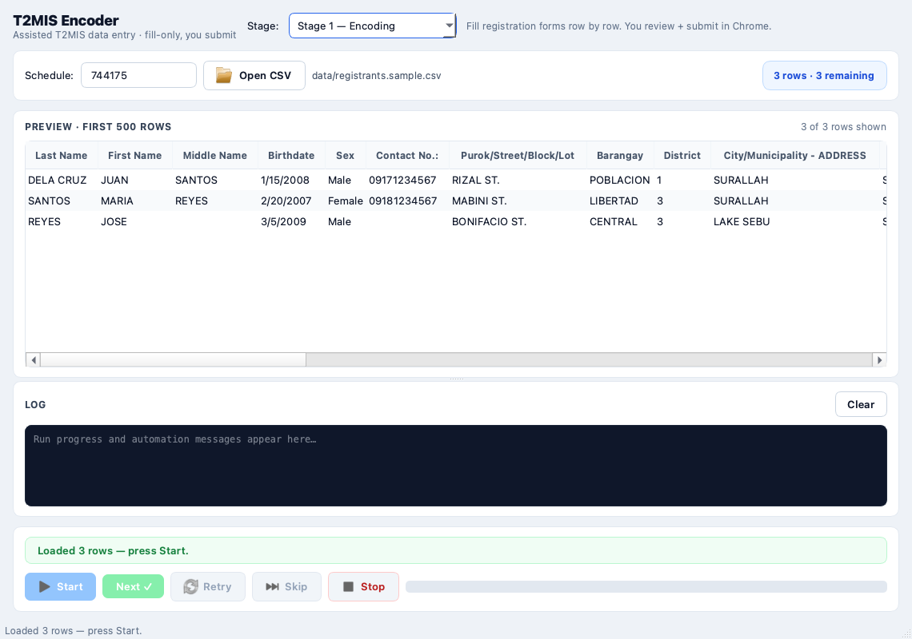

# T2MIS Encoder


Assisted data-entry tool for the TESDA T2MIS learner registration portal.
It reads a verified masterlist CSV and fills the registration form row by row
with Selenium — while a human operator reviews and submits every record.



## Contents

- [Features](#features)
- [Safety by design](#safety-by-design)
- [Requirements](#requirements)
- [Quickstart](#quickstart)
- [Usage](#usage)
  - [Stage 1 — Encoding](#stage-1--encoding)
  - [Stage 2 — Enrollment](#stage-2--enrollment)
  - [Stage 3 — Attendance sheets](#stage-3--attendance-sheets)
- [CSV file reference](#csv-file-reference)
- [How it works](#how-it-works)
- [Project structure](#project-structure)
- [Privacy](#privacy)
- [Troubleshooting](#troubleshooting)
- [Packaging](#packaging)
- [Legacy CLI](#legacy-cli)
- [Contributing](#contributing)
- [License](#license)

## Features

| Stage | What it does | Input |
| :--- | :--- | :--- |
| **1 — Encoding** | Fills the T2MIS registration form from each pending row | Masterlist CSV (`Done` flag) |
| **2 — Enrollment** | Searches learners by ID, then autofills the enroll-details form | Enrollees CSV (`Enrolled` flag + learner-ID column) |
| **3 — Attendance** | Generates printable attendance sheets (DOCX), fully offline | Enrollees CSV + date range |

Common behavior across stages:

- CSV preview (first 500 rows) with per-row status (`queued` / `filling` / `review` / `done` / `failed`)
- `Start / Next / Retry / Skip / Stop` run controls with keyboard shortcuts
- Dark-theme activity log with progress bar and row counter
- Crash-safe progress: every confirmed row is persisted to the CSV immediately,
  so an interrupted run resumes where it left off

## Safety by design

The tool is **fill-only**. It never clicks `sendRegister`, `Search`-submit
bypasses, `Enroll` links, or `Create` buttons. Every row pauses for manual
review, and only the operator submits in the browser. T2MIS login is manual —
credentials are never stored, read from disk, or passed on the command line.

## Requirements

- macOS with Google Chrome installed
- Python 3.12 (managed with [`uv`](https://docs.astral.sh/uv/))
- A T2MIS account (you log in by hand in the opened Chrome window)

Dependencies are declared in `pyproject.toml` and locked in `uv.lock`:

- `selenium` — form automation (chromedriver resolves via Selenium Manager,
  nothing to install separately)
- `PySide6` — desktop app
- `python-docx` — Stage 3 attendance generation

## Quickstart

```sh
uv sync
./run_app.sh            # desktop app (or: .venv/bin/python -m app.main)
```

1. Place the verified masterlist at `data/registrants.csv`.
   Schema references with fictitious rows: `data/registrants.sample.csv`
   (Stage 1) and `data/enrollees.sample.csv` (Stages 2–3).
2. Open the CSV in the app and press **Start**. Chrome opens on the T2MIS
   home page — log in there, then press **Continue** in the app.
3. The tool fills one pending row. Review it in Chrome, submit it yourself,
   then press **Next** to flag the row done and advance.

## Usage

### Stage 1 — Encoding

Select **Stage 1 — Encoding**, open the masterlist, and press **Start**.
For each pending row the tool fills names, birthdate, birthplace chain
(`Region → Province → City`), present-address chain, sex, contact/address
fields, district, and the consent radios — then waits. You check the form,
click through submission in Chrome, and press **Next ✓** (`Ctrl+Enter`).
`Retry` (`F5`) refills the row; `Skip` moves on without flagging it.

### Stage 2 — Enrollment

Select **Stage 2 — Enrollment** and open an enrollees CSV (masterlist schema
plus a learner-ID column such as `Learner's ID`, plus `Enrolled`).
After login, the app asks you to open the training schedule in Chrome
(`Register → schedule → Enroll`) until the Search Student form is showing.
From there, per row:

1. The tool fills the learner ID and searches — then waits.
2. Verify the match in Chrome and click **Enroll** yourself.
3. Press **Fill Form**. The tool autofills the details form (civil status,
   education, client type, disability, employment) — then waits again.
4. Review, click **Create** yourself, and press **Next ✓**.

If no learner matches, the row is marked `no match` so you can check the ID,
`Retry`, or `Skip`. A per-row `SchSchedId` column overrides the Schedule
textbox when present.

### Stage 3 — Attendance sheets

Select **Stage 3 — Attendance**, open an enrollees CSV, type the school and
program names, pick a start/end date and weekdays. The preview line shows
student count, days, hours, and sheet count. **Generate DOCX** writes one
Word file from `attendance_template.docx` (31 students per sheet, 8 hrs/day,
one page per date).

## CSV file reference

Stage 1 requires these headers (Stage 2 adds a learner-ID column):

> `Last Name`, `First Name`, `Birthdate`, `Region`, `Province`,
> `City/Municipality`, `Region - ADDRESS`, `Province - ADDRESS`,
> `City/Municipality - ADDRESS`, `Sex`

Optional columns: `Middle Name`, `Purok/Street/Block/Lot`, `Barangay`,
`District`, `Contact No.:`. Stage 2 also reads `Learner's ID` (or `ULI`
variants), `SchSchedId` (override), and details columns (`Civil Status`,
`Educational Attainment`, `Learner/Trainee/classification`,
`Type of Disability`, `Employment Status`).

Progress flags (case-insensitive, any of `TRUE / 1 / yes / done / x`):

| Flag | Meaning |
| :--- | :--- |
| `Done` | Stage 1 row reviewed + submitted |
| `Enrolled` | Stage 2 row enrolled |

Missing flags are added automatically on load.

## How it works

| Step | Detail |
| :--- | :--- |
| Load | CSV parsed as `utf-8-sig`; required headers validated; progress flags honored |
| Fill | Text fields via `send_keys` plus `input`/`change` event dispatch for page validators |
| Matching | Dropdowns resolve by exact → token-weighted → `difflib` match (tolerates e.g. `REGION XII` vs `XII - SOCCSKSARGEN`) |
| Cascades | `Region → Province → City` (birth and present address) plus `City → District`, each with explicit AJAX waits |
| Normalization | Dates zero-padded to `mm/dd/yyyy`; numeric districts mapped to Roman (`3 → III`) |
| Consent | `Allow=True` / `Continue=Yes` radios clicked natively so the page `check()` validator fires |
| Threading | Selenium runs on a `QThread` worker; the GUI only exchanges signals, never touches the driver |
| Resilience | Stale-element retries, click-intercept fallback, per-row immediate persistence |

## Project structure

```
app/
  main.py                    # QApplication entry
  ui/
    main_window.py           # window: file card, preview, controls, log, attendance
    styles.py                # central QSS theme
  services/
    automation.py            # Selenium fill/search engine (Qt-free)
    csv_loader.py            # CSV load, validation, Done/Enrolled persistence
    browser.py               # webdriver factory (Selenium Manager chromedriver)
    attendance.py            # Stage 3 DOCX batch generator (Qt-free)
  workers/
    selenium_worker.py       # QThread bridge (signals only, no widgets)
data/
  registrants.sample.csv     # Stage 1 schema reference (fictitious rows)
  enrollees.sample.csv       # Stages 2–3 schema reference (fictitious rows)
docs/
  screenshot.png             # app screenshot
attendance_template.docx     # Stage 3 template ({INSERT SCHOOL/PROGRAM/DATE})
main.py                      # legacy terminal filler (see below)
run_app.sh                   # launcher: .venv/bin/python -m app.main
```

## Privacy

Real masterlists contain learner PII and are **never committed** — the
`data/*.csv` ignore rule covers them; only the redacted samples are tracked.
The tool sends nothing anywhere except the T2MIS pages it fills in your own
Chrome window. No analytics, no credentials on disk.

## Troubleshooting

| Symptom | Fix |
| :--- | :--- |
| `Missing required columns` on open | Compare headers against [CSV file reference](#csv-file-reference); watch for renamed or merged header cells from spreadsheet exports |
| `Missing learner-ID column` (Stage 2) | Add a `Learner's ID` (or `ULI`) column — filled from your sheet between stages |
| `No match for RegionId=…` | Check the spelling against the T2MIS dropdown; the fuzzy matcher handles most variants but not typos |
| `Search Student form not found` (Stage 2) | Navigate Chrome to the schedule's Enroll page until the search form shows, then Continue again |
| `Template missing` (Stage 3) | `attendance_template.docx` must sit next to `run_app.sh` at the repo root |
| Chrome opens but login stalls | Log in manually in that window, then press Continue in the app dialog |
| Row fails mid-fill | Read the log line, fix the page state if needed, and `Retry` — nothing is marked done until you press Next |

## Packaging

For a distributable `.app`, bundle with PyInstaller (`--windowed --onedir`)
and wrap in a DMG. Distribution outside the App Store requires a Developer ID
signature and notarization for Gatekeeper.

## Legacy CLI

`main.py` at the repo root is the original terminal-driven Stage 1 filler,
kept for reference and headless use. It shares the same fill semantics as
`app/services/automation.py` but runs outside the desktop app:

```sh
.venv/bin/python main.py   # expects data/registrants.csv; prompts in the terminal
```

New work should target the desktop app; the CLI receives no new features.

## Contributing

1. Create a feature branch from `main`.
2. Keep automation code Qt-free (`app/services/`) and widget code out of the
   worker (`app/workers/` exchanges signals only).
3. Verify with `uv sync` and a dry run of the desktop app before opening a PR.
4. Never commit real learner data — samples only.

## License

MIT — see [LICENSE](LICENSE).
